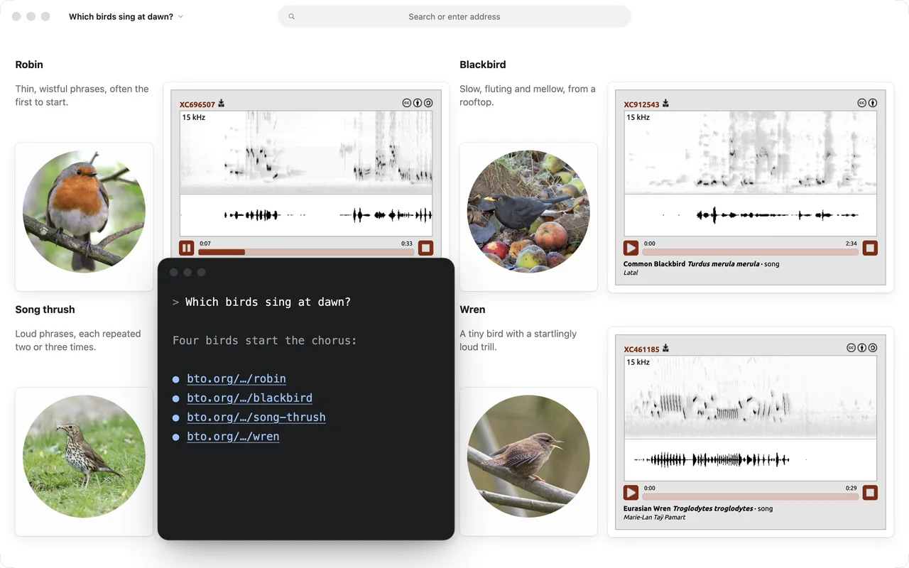

# Banquish for Claude Code

Banquish lets your agent answer with the live web. Ask a question, and instead of a wall of text and links, Claude opens the real pages in Banquish, takes the parts that answer you (a price, a chart, a player, a table) and composes them into a Workspace beside your terminal. Those parts are live pieces of the sites themselves, so they keep updating, and you can click, play and scroll them. Banquish is a Mac app (Apple silicon); this repository is its Claude Code plugin.



## Install

First install the Banquish app:

- Download it from [banquish.space](https://banquish.space), or
- with Homebrew: `brew install --cask banquish-app/tap/banquish`

Open Banquish once. Each launch installs `~/.banquish/bin/banquish`, the command agents run, and its **Connect your agent** card sets up the agents below.

### Claude Code

Add this plugin:

```
/plugin marketplace add banquish-app/banquish-plugin
/plugin install banquish@banquish
```

Then pair it with Banquish once:

1. Open Banquish, and keep it open while you use it.
2. In Claude Code, run `/mcp`, choose `banquish`, then Authenticate. A Banquish page opens in your browser and asks for a code.
3. In Banquish, choose **File › Connect Claude…**, type the pairing code it shows into that page, and choose **Pair**.

Then ask something like "compare the three cheapest flights to Lisbon next Friday, show it in Banquish".

The plugin adds:

- the `banquish` MCP server, at Banquish's Relay, `https://mcp.banquish.space/mcp`, which passes Claude Code's calls to the Banquish app on your Mac;
- the `banquish` skill, which tells Claude when to answer in Banquish and how to help you set it up when it's missing.

**Already clicked Add to Claude Code in Banquish?** Then you don't need this plugin's server: that connection runs on your Mac without the Relay, and it's faster. Use one or the other, so Claude Code doesn't see Banquish's tools twice.

### Codex

In Banquish, click **Add to Codex** under Connect your agent, then start a new Codex session.

### Claude Desktop

In Banquish, click **Add to Claude Desktop** under Connect your agent, then quit Claude Desktop and open it again.

### Any other MCP client

In Banquish, open **Any other MCP client** under Connect your agent and click **Copy**. Add the configuration it copies to your client's MCP settings. It runs `~/.banquish/bin/banquish mcp` over stdio.

## What runs on your machine

The plugin contains no code and runs nothing on your Mac. Its MCP server is Banquish's Relay, which passes each call to the Banquish app on your Mac and back, and keeps none of what passes through it. Banquish then opens the pages your agent asks for, signed in as you. When your Mac is asleep or Banquish is closed, calls fail until you open it again.

## Privacy

See [banquish.space/privacy](https://banquish.space/privacy) for what Banquish and its site collect.

## Support

Open an issue in this repository, or write to [hello@banquish.space](mailto:hello@banquish.space). News and build notes: [@gunhboo](https://x.com/gunhboo) on X.

## License

The plugin is MIT licensed; see [LICENSE](LICENSE). The Banquish app is distributed separately.
